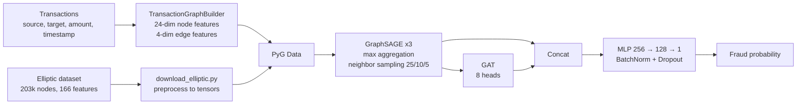

# FraudMap: GNN-based AML detection

FraudMap treats a set of financial transactions as a directed graph: accounts are nodes and transfers are edges. A hybrid GraphSAGE + GAT model then scores each account for fraud or money-laundering risk. The aim is to catch network-level patterns such as smurfing, layering and round-tripping, which rule-based systems miss because they look at one transaction at a time.

> **Status: early-stage research prototype.** This repo holds the model, the graph construction code, the data pipeline and the training loop. No training results are published yet. Everything listed under *Planned* is design work, not working code.

The project started in team GraphSentinel's TEKNOFEST 2026 AI work, and I'm continuing it as my final-year project. This is a curated public version of a private team repository.

## Architecture



## Implemented

| Component | File | Description |
|---|---|---|
| Hybrid GNN | `src/model/fraudmap.py` | 3-layer GraphSAGE (max aggregation), followed by a multi-head GAT. Both outputs are concatenated and passed to an MLP head. Can return GAT attention weights and node embeddings. |
| Trainer | `src/model/trainer.py` | Mini-batch training with `NeighborLoader`, class-weighted BCE for imbalance, gradient clipping, `ReduceLROnPlateau`, early stopping on validation F1, checkpointing. Evaluation reports precision, recall, F1 and ROC-AUC. |
| Graph builder | `src/graph/builder.py` | Turns a transaction DataFrame into a PyG `Data` object. Node features are 24-dim per account: windowed counts and amounts, night and weekend ratios, counterparty counts, degrees. Edge features are 4-dim: log amount, time delta, pair frequency, direction. |
| Elliptic pipeline | `data/scripts/download_elliptic.py` | Downloads the [Elliptic Bitcoin dataset](https://www.kaggle.com/datasets/ellipticco/elliptic-data-set) through the Kaggle API (manual download also works) and saves features, edges, labels and time steps as tensors. |
| Config and logging | `src/core/`, `configs/model_config.yaml` | Pydantic settings, structlog, hyperparameters. |
| API skeleton | `src/api/main.py` | FastAPI app with a health check. The stats endpoint returns placeholder values. |

## Planned (not implemented)

- A training entry point that connects the Elliptic tensors to the trainer. This includes mapping the labels: Elliptic uses 0 = unknown, 1 = illicit and 2 = licit, while the trainer expects binary labels and a train/val mask.
- Baselines (XGBoost and a plain GraphSAGE) and temporal train/test splits on Elliptic, with published metrics.
- Synthetic Turkish-banking scenarios built with AMLSim: smurfing, layering, structuring, round-trip.
- Explainability with GNNExplainer.
- Streaming ingestion (Kafka), a graph store (Neo4j) and an alert dashboard.
- Draft generation for suspicious-transaction reports.

## Tech stack

Python, PyTorch, PyTorch Geometric, scikit-learn, pandas, FastAPI, Pydantic, structlog.

## Structure

```
configs/model_config.yaml        hyperparameters
data/scripts/download_elliptic.py
src/core/                        settings, constants, logging
src/graph/builder.py             transactions → PyG graph
src/model/fraudmap.py            GraphSAGE + GAT model
src/model/trainer.py             training / evaluation loop
src/api/main.py                  FastAPI skeleton
```

## Running

```bash
python -m venv .venv && source .venv/bin/activate
pip install -e ".[data]"

# Elliptic dataset (needs ~/.kaggle/kaggle.json, or download manually into data/raw/elliptic/)
python data/scripts/download_elliptic.py

# API skeleton
uvicorn src.api.main:app --reload
```

There is no end-to-end training command yet; see *Planned*. To use the model and trainer directly:

```python
from src.model.fraudmap import FraudMapGNN
from src.model.trainer import FraudMapTrainer

model = FraudMapGNN(in_channels=166)          # 166 for Elliptic, 24 for the transaction builder
trainer = FraudMapTrainer(model=model, device="cpu")
history = trainer.train(data, train_mask, val_mask)  # data.y must be binary
```

## My role

I designed the system and wrote the code: the model architecture, the feature design, the graph builder, the data pipeline and the training loop.

## License

MIT
